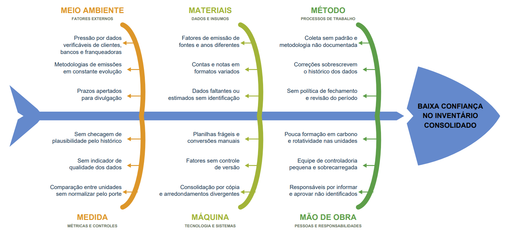

# Visão do produto — CarbonTrace

Grupo 05 · Revisão de 23/10/2026 · [ADR-008](adr/ADR-008-recorte-crud.md).

## Cliente, usuário e objetivo

O cliente pretendido é uma rede de varejo ou franquias, com ESG/controladoria interessados na coleta mensal e na origem dos números. O usuário é **o funcionário responsável pela coleta**, com login individual e acesso a todas as unidades da própria empresa. Todos têm as mesmas funcionalidades. Não há perfis de gestor ESG, controladoria, gerente restrito à unidade ou auditor na aplicação.

A dor investigada é a dispersão em planilhas, preenchimento inconsistente e correções que dificultam reconstruir os cálculos. Frequência, economia de trabalho e interesse comercial ainda não foram comprovados.

**Objetivo:** substituir a planilha por CRUD guiado de consumos, com cálculo versionado, consolidação da rede e PDF/CSV rastreável. Não alegar inventário completo homologado ou superioridade comercial sem evidências.

O Ishikawa é contexto histórico, não pesquisa concluída ou lista de entregas. Aprovação, fechamento, comparação por área e plausibilidade histórica aparecem como causas possíveis, mas não serão tratados neste MVP.

## Cinco jornadas preservadas

| Jornada | Entrega | Histórias |
| --- | --- | --- |
| J1 | Cadastrar/editar/desativar unidades e vincular fontes do catálogo | CT-M01/M02 |
| J2 | Cadastrar, consultar, corrigir e cancelar consumos com histórico | CT-M03/M07/M11 |
| J3 | Calcular e reproduzir usando versões explícitas | CT-M04/M05/M09 |
| J4 | Totais, ranking, mediana e alertas da rede | CT-M08/M12 |
| J5 | PDF/CSV do mesmo snapshot com origem dos dados | CT-M09/M10 |

## Regras do produto

### Cadastro e coleta

Unidade tem código único na empresa, nome e estado ativo/inativo. Área e vínculo própria/franqueada não são obrigatórios. Fontes vinculadas vêm do catálogo fixo: eletricidade (Escopo 2 por localização), diesel de frota, gasolina de frota e GLP estacionário (Escopo 1). Não há tipo livre ou refrigerantes.

Um lançamento lógico por unidade/fonte/competência YYYY-MM. Eletricidade aceita kWh/MWh (1 MWh = 1.000 kWh), diesel/gasolina L, GLP kg. Zero explícito é aceito; ausência, negativo, NaN/infinito, competência inválida e unidades incompatíveis são rejeitados. Não se presume detectar número errado com unidade declarada válida.

Entrada contém UID do autor, instante, quantidade/unidade originais e revisão. Reenvio idêntico não duplica. Correção exige motivo e cria revisão ligada à anterior; altera quantidade/unidade compatível, não a identificação unidade/fonte/competência. Para identificação errada, cancelar e cadastrar em outra chave.

Cancelamento exige confirmação e motivo, cria revisão e retira o lançamento dos totais correntes sem apagar origem. Não há exclusão física. A chave continua reservada; reativação não está no MVP e essa limitação deve ser avisada antes da confirmação. Desativar unidade/fonte impede novas coletas, mas preserva entradas/cálculos e não subtrai valores silenciosamente.

### Fatores, precisão e reprodução

A equipe prepara versões A/B e uma metodologia fixa identificada, sem tela/API de publicação. Fator tem ID/versão, fonte, valor/unidade, escopo, referência, vigência e status de conferência. Versões publicadas são imutáveis. Novo cálculo escolhe versão compatível mais recente vigente na competência; ausência de fator compatível gera erro.

A fórmula é quantidade convertida × fator agregado em kgCO2e/unidade. Premissas de GWP/gases incorporados ao fator ficam documentadas na metodologia fixa, sem seleção AR5/AR6 ou motor por gás. Fatores não conferidos permanecem preliminares; a estimativa não equivale a inventário completo homologado.

Cada cálculo salvo é um snapshot de empresa/período, unidades/fontes esperadas, revisões, conversões, fatores, metodologia, autor, data e resultados. Correção/cancelamento cria novo resultado corrente, preservando o anterior. Recalcular snapshot antigo usa suas próprias entradas e fatores e deve produzir diferença zero. Fator B ou mudança de configuração só podem afetar novos snapshots.

Domínio usa Decimal; JSON/banco usam strings decimais. Somar valores exatos antes de arredondar. Exibição usa 3 casas e ROUND_HALF_EVEN. Informar diferença entre soma das parcelas exibidas e total exibido quando existir. Não usar ROUND_HALF_UP. Guardar a política/metodologia no snapshot.

### Dashboard e mediana

Selecionar competência/snapshot recorta todos os componentes igualmente. Total da rede inclui uma única revisão corrente válida/não cancelada por lançamento, inclusive totais parciais rotulados. Ausência de coleta é pendência, nunca zero automático.

Ranking e mediana incluem somente unidades ativas com pelo menos uma fonte esperada e coleta completa no snapshot. Zero explícito continua válido. Ranking por total kgCO2e decrescente, desempate por código, sem comparação de eficiência por área.

Com ≥3 unidades completas e mediana >0, desvio = (valor−mediana)/mediana×100. Alerta se valor absoluto **>50%**, antes de arredondar; exatamente ±50% não alerta. Mediana zero/amostra insuficiente: nenhuma classificação e aviso. É alerta operacional, não teste estatístico.

### Relatórios

PDF/CSV recebem o mesmo ID de snapshot salvo. Identificam empresa, competência, snapshot, unidade/fonte, valores/unidades originais, conversão, fator/versão/referência/status, metodologia, revisão, UID do autor e datas do registro/cálculo. Indicar completude/pendências. PDF deve avisar sobre números preliminares; CSV leva esse status nas linhas.

Geração síncrona, sem jobs, Storage obrigatório, link assinado, fechamento, hash, assinatura ou manifesto. Exportação de snapshot antigo não consulta valores correntes. Data de geração pode mudar; os dados daquele snapshot permanecem. Sem registros, CSV tem cabeçalho e PDF informa ausência, sem simular consumo zero.

## Cortes e marcos

Fora do MVP: quatro perfis, gestão de usuários, aprovação/fechamento/reabertura, auditor convidado, intensidade por área, MAD/z modificado, seleção GWP, refrigerantes e infraestrutura criptográfica. Permanecem exclusões originais: Escopo 3, OCR, concessionárias, certificação e créditos; também ERP, anexos, aplicativo nativo e benchmark entre clientes.

| Marco em 2026 | Planejamento |
| --- | --- |
| 25/10 — Sprint 2 | J1/J2 e base do cálculo, primeiras evidências |
| 01/11 — Sprint 3/CP2 | J1–J4 locais, revisões/cancelamentos, segurança, EP/BVA, contrato e relatório |
| 15/11 — CP3 | Publicação/operação conforme caderno; J5 continua obrigatória no backlog |
| 29/11 — CP4 | Estabilização, qualidade, rollback e custos |
| 05/12 — Demo Day | Cinco jornadas homologadas, inclusive J5 |

J5 não foi adicionada às 20 issues atuais. Seu planejamento posterior deve ser explicitado antes do Demo Day. A revisão deve ser apresentada ao tutor; não aprova automaticamente o gate.

## Tecnologia, custos e validação

Manter React/TypeScript, FastAPI/Python, Firestore, Firebase Authentication, Docker Compose, GitHub Actions, Cloud Run e Firebase Hosting. API autoriza o tenant obtido do token; Firestore direto deny-all. Claims: tenant_id e papel=funcionario; provisionamento pela equipe.

US$ 3–8 é estimativa, não gasto ou garantia. Registrar acumulado com fonte/data: CP2 ≤US$5, CP3 ≤US$12, ciclo ≤US$50; agir a US$40. Emuladores não comprovam custo zero.

Não reduzir exigências do caderno: CP2 com 3–5 jornadas (planejadas J1–J4), estados de UI, segurança, EP/BVA, testes de contrato/prioridades, matriz e relatório, paginação/queries controladas. Nos marcos posteriores: cobertura ≥80% domínio/≥60% global, autorização em todas as rotas, Lighthouse ≥90, p95 leitura ≤800ms/escrita ≤1,5s, vulnerabilidades, rollback e operação conforme caderno. Mudanças dessas exigências dependem do tutor.

A demo usa dados sintéticos, duas empresas isoladas e ≥3 unidades completas na empresa demonstrada. Fatores reais exigem conferência de fonte/condições de uso antes de serem apresentados como verificados. Dados pessoais mínimos, UID nas trilhas e logs sem nome/e-mail; não declarar conformidade jurídica já validada.

Validar com 3 participantes se cada um registra 4 fontes em ≤5 minutos, sem assistência. Comparar com planilha somente com evidência consentida e equivalente. Ver [plano de validação](validacao/validacao-problema-e-defensibilidade.md).

## Estado de implementação

Este texto e OpenAPI 0.2.0 são alvo aprovado de produto, não comportamento já entregue. A base de CarbonTrace ainda precisa ser adequada e testada. Apenas PR, teste, CI e documentação evidenciam conclusão; esta revisão não modifica aquele repositório.
